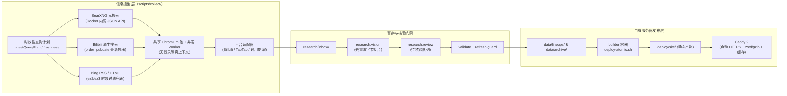

# 自有服务器架构与迁移部署指南

## 重构后架构总览



## 1. 今日迁移准备

1. 在服务器克隆仓库后，复制环境变量模板：

```sh
cp .env.example .env
```

2. 按需编辑 `.env`：
   - `SITE_URL=https://你的域名`（若仅 IP 测试，可用 `http://服务器IP`）
   - `SITE_DOMAIN=你的域名`（若仅 IP/HTTP 测试，保持 `:80`）
   - `SITE_BASE=`（自有服务器默认根路径 `/` 留空即可）
   - `SEARXNG_URL=http://searxng:8080`

## 2. 启动站点与元搜索引擎

```sh
docker compose up -d web searxng
docker compose run --rm builder
```

验证服务：

```sh
curl -fsS http://127.0.0.1/healthz
```

## 3. 搜集最新阵容与审核上线

- **手动触发当季最新搜集**（含 SearXNG、Bilibili 最新投稿、共享浏览器池与待核验队列摘要）：

```sh
docker compose run --rm collector
```

- **定时搜集（推荐每天 2 次，仅入库候选不自动上线）**：在宿主机 `crontab -e` 添加：

```cron
0 9,21 * * * cd /path/to/roco-pvp-meta && docker compose run --rm collector >> /var/log/roco-collector.log 2>&1
```

- **核验新阵容并零停机发布**：
  1. 查看 `npm run research:review` 输出的候选图与来源，核对 `vision/` 切片与原帖。
  2. 将已核实阵容写入 `data/lineups/<slug>.json` 并保存原图到 `public/assets/lineups/<slug>/`。
  3. 执行构建与原子发布：

```sh
docker compose run --rm builder
```
